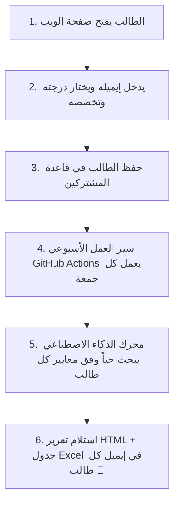

# 🎓 Global Scholarship AI Tracker & Email Automation Engine
### محرك الذكاء الاصطناعي الشامل لتتبع وتدقيق وإرسال المنح الدراسية تلقائياً 🚀

[](.github/workflows/weekly_scholarship.yml)
[](web/app.py)
[](https://www.python.org/)
[](https://aistudio.google.com/)
[](LICENSE)

---

## 🌟 نظرة عامة (Overview)

**Global Scholarship AI Tracker** هو نظام أوتوميشن ذكي ومفتوح المصدر، صُمم خصيصاً لمساعدة الطلاب (وبالأخص الطلاب من **فلسطين** والوطن العربي) في العثور على أحدث **المنح الدراسية للبكالوريوس والدراسات العليا** المفتوحة حالياً للتقديم أو التي تفتح في المستقبل القريب جداً.

يقوم النظام بالبحث المستقل عبر الإنترنت والتحقق من المواقع الرسمية للجامعات والجهات المانحة، ثم يرسل تقريراً أسبوعياً مفصلاً إلى بريد كل طالب بصيغة **HTML تفاعلية فخمة** ومرفق بجدول بيانات **CSV احترافي يضم 11 عاموداً معيارياً باللغة الإنجليزية**.

> [!TIP]
> **الآن مع منصة ويب عصرية متكاملة (Web App)!** يستطيع أي طالب الدخول من هاتفه، كتابة إيميله واختيار تخصصاته ومرحلته الدراسية (بكالوريوس / ماجستير / دكتوراه)، وسيتولى النظام أسبوعياً إرسال تقرير مخصص له مجاناً وبدون أي سيرفرات!

---

## ✨ المميزات الرئيسية (Key Features)

* **🌐 منصة ويب تفاعلية وسريعة (Web Application):**
  واجهة مستخدم عصرية باللغة العربية مبنية بـ **FastAPI & Tailwind CSS**، تتيح للطلاب التسجيل في 20 ثانية من أي متصفح هاتف أو كمبيوتر.
* **📅 أوتوميشن أسبوعي لجميع المشتركين (Weekly Multi-Student Dispatcher):**
  يعمل تلقائياً كل أسبوع (يوم الجمعة) عبر **GitHub Actions**، يمر على كافة الطلاب المسجلين ويبحث حياً وفق معايير كل طالب ثم يرسل له تقريره.
* **📧 تقارير بريد إلكتروني فخمة (Luxury HTML Email):**
  تصميم متجاوب بالكامل يحتوي على كروت ملونة، حالات المنح (مفتوح حالياً / يفتح قريباً)، وتفاصيل التمويل، وشروط القبول، ودعم التأشيرة، وروابط التقديم الرسمية المباشرة.
* **📊 جدول بيانات CSV معياري بـ 11 عاموداً:**
  مرفق تلقائياً مع كل رسالة بريد إلكتروني لتتمكن من فتحه في **Excel** أو **Google Sheets** بسهولة.
* **🔍 بحث حي ومستقل بالذكاء الاصطناعي:**
  استخراج حي لأحدث المنح عبر محركات البحث وربطها بنماذج `Google Gemini` مع سلاسل تحويل احتياطية (Failover Chain) تضمن عدم توقف الخدمة.
* **💬 بوت تيليجرام تفاعلي (Interactive Telegram Bot):**
  واجهة محادثة إضافية تتيح للطلاب البحث المباشر والاشتراك عبر تيليجرام.

---

## 📋 الأعمدة الـ 11 في جدول التقرير (Data Matrix)

يتضمن كل تقرير يتم توليده تفاصيل دقيقة وشاملة لكل منحة باللغة الإنجليزية:
1. **Scholarship & Provider Name** (اسم المنحة والجهة المانحة).
2. **Country / Institution** (الدولة والجامعة المستضيفة).
3. **Language of Instruction** (لغة الدراسة والبرامج التحضيرية).
4. **Application Status** (الحالة: مفتوح حالياً Open Now أو يفتح قريباً).
5. **Application Deadline** (تاريخ الموعد النهائي الدقيق).
6. **Application Mechanism** (آلية التقديم: مدمج أو منفصل).
7. **Academic & General Requirements** (المعدل المطلوب وشروط اللغة).
8. **Standardized Tests** (شروط SAT / ACT / GRE أو اختبارات القبول المحلية).
9. **Visa Support & Facilitation** (تسهيلات التأشيرة وخطابات الدعم).
10. **Competitiveness & Acceptance Rate** (مستوى التنافسية ونسبة القبول).
11. **Direct Official Link** (الرابط المباشر للبوابة الرسمية).

---

## 🚀 تشغيل منصة الويب محلياً (Run Web App Locally)

يمكنك تشغيل خادم الويب على جهازك واستقبال اشتراكات الطلاب فوراً:

```bash
# تشغيل خادم FastAPI
uvicorn web.app:app --host 0.0.0.0 --port 8000 --reload
```
افتح المتصفح على: **`http://localhost:8000`** وستظهر لك صفحة الهبوط التفاعلية الفاخرة! 🌟

---

## ☁️ نشر منصة الويب مجاناً على الإنترنت (1-Click Free Cloud Deploy)

يمكنك نشر المنصة على **[Render.com](https://render.com/)** أو **Vercel** مجاناً في دقيقة واحدة لتعمل طوال 24 ساعة:
1. اربط حساب GitHub الخاص بك بموقع **Render.com**.
2. اختر **New Web Service** وحدد مستودعك: `scholarship-automation`.
3. اضبط أمر التشغيل: `uvicorn web.app:app --host 0.0.0.0 --port $PORT`.
4. أضف المتغيرات البيئية (`GEMINI_API_KEY`, `SENDER_EMAIL`, `GMAIL_APP_PASSWORD`).
5. ستحصل فوراً على رابط مباشر خاص بك (مثل: `https://scholarship-automation.onrender.com`) لتشاركه مع كل الطلاب!

---

## 👥 كيف يستفيد أي طالب في العالم من المنظومة؟



1. **الاشتراك:** يدخل الطالب إلى صفحة الويب، يكتب إيميله، يختار (بكالوريوس / ماجستير / دكتوراه)، ويحدد تخصصاته، ويضغط "تفعيل الاشتراك".
2. **التقرير الترحيبي:** يصله إيميل تأكيدي مع أول تقرير تجريبي لمطالعة الفرص المتاحة فوراً.
3. **الأوتوميشن الأسبوعي:** كل يوم جمعة في تمام الساعة 10:00 صباحاً، يقوم GitHub Actions بتشغيل محرك الإرسال الجماعي `dispatch_weekly_subscribers.py` وتوصيل أحدث المنح الموثقة لكل طالب مجاناً.

---

## 💻 التشغيل والتطوير المحلي (Local Development)

### خطوات التثبيت والتشغيل
1. **استنساخ المستودع:**
   ```bash
   git clone https://github.com/medozaiter/scholarship-automation.git
   cd scholarship-automation
   ```

2. **إنشاء البيئة الافتراضية وتفعيلها:**
   ```powershell
   python -m venv venv
   .\venv\Scripts\activate
   ```

3. **تثبيت الحزم المطلوبة:**
   ```bash
   pip install -r requirements.txt
   ```

4. **إعداد ملف المتغيرات البيئية `.env`:**
   انسخ ملف `.env.example` إلى `.env`:
   ```bash
   cp .env.example .env
   ```
   ثم افتح `.env` وضع بياناتك:
   ```env
   SENDER_EMAIL=your_email@gmail.com
   GMAIL_APP_PASSWORD=xxxx-xxxx-xxxx-xxxx
   RECIPIENT_EMAIL=your_email@gmail.com
   GEMINI_API_KEY=your_gemini_api_key
   GEMINI_MODEL=gemini-3.5-flash-lite
   ```

5. **تشغيل منصة الويب:**
   ```bash
   uvicorn web.app:app --host 0.0.0.0 --port 8000 --reload
   ```

6. **تشغيل الإرسال الأسبوعي لكافة المشتركين يدوياً:**
   ```bash
   python dispatch_weekly_subscribers.py
   ```

---

## 📂 هيكلية المشروع (Project Architecture)

```text
scholarship-automation/
├── .github/
│   └── workflows/
│       └── weekly_scholarship.yml    # تشغيل الأوتوميشن الأسبوعي السحابي عبر GitHub Actions
├── data/
│   ├── subscribers.json              # سجل بيانات الطلاب المشتركين
│   └── subscribers.example.json      # نموذج توضيحي لملف المشتركين
├── web/
│   ├── __init__.py
│   └── app.py                        # خادم FastAPI + واجهة الويب التفاعلية (Landing Page)
├── services/
│   ├── scholarship_engine.py         # محرك البحث الذكي والاستخراج المباشر بـ 11 عاموداً
│   ├── subscriber_service.py         # خدمة إدارة اشتراكات الطلاب
│   ├── gemini_service.py             # تكامل Google Gemini مع سلاسل التحويل التلقائي
│   ├── search_service.py             # محرك البحث المخصص (DuckDuckGo + المصفوفات المحققة)
│   ├── broadcast_service.py          # خدمة البث التلقائي في القنوات
│   └── cache_service.py              # تخزين مؤقت للنتائج لتوفير استهلاك الـ API
├── dispatch_weekly_subscribers.py    # مشغل الإرسال الدوري الجماعي لجميع الطلاب المسجلين
├── send_scholarship_report.py        # المحرك الفردي لإرسال تقرير مخصص
├── config.json                       # ملف إعدادات الطالب الشخصي
├── config.example.json               # قالب توضيحي للإعدادات
├── main.py                           # بوت التيليجرام التفاعلي (اختياري)
├── requirements.txt                  # مكتبات بايثون المطلوبة
├── Procfile                          # ملف تشغيل السحابة (Cloud Deployment)
├── render.yaml                       # تكوين النشر بنقرة واحدة على Render
├── .env.example                      # نموذج لمتغيرات البيئة
└── README.md                         # التوثيق الشامل ودليل الاستخدام
```

---

## 🔒 الأمان وحماية الخصوصية (Security & Privacy)

* جميع البيانات الحساسة (كلمات مرور التطبيقات ومفاتيح الـ API) مشفرة ومحمية عبر ملف `.gitignore` ولا يتم رفعها إطلاقاً إلى المستودع.
* في بيئة GitHub Actions، تُحفظ الأسرار في **GitHub Encrypted Secrets** ولا يمكن لأي شخص الاطلاع عليها أو نسخها.
* لا يتم مشاركة أو بيع إيميلات الطلاب المسجلين نهائياً، وتستخدم حصراً لإرسال دليل المنح.

---

## 📄 الترخيص (License)

هذا المشروع مرخص تحت رخصة **MIT** - متاح مجاناً للجميع لدعم الطلاب والتعليم.

---

<div align="center">
  <b>صُمم بحب لدعم الطلاب الطموحين في فلسطين وحول العالم 🇵🇸🎓</b><br>
  تم تطويره وإدارته بواسطة <a href="https://github.com/medozaiter"><b>Mustafa AbuZaiter</b></a>
</div>
