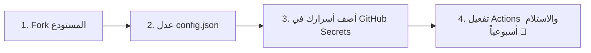

# 🎓 Global Scholarship AI Tracker & Email Automation Engine
### محرك الذكاء الاصطناعي الشامل لتتبع وتدقيق وإرسال المنح الدراسية تلقائياً 🚀

[](.github/workflows/weekly_scholarship.yml)
[](https://www.python.org/)
[](https://aistudio.google.com/)
[](LICENSE)

---

## 🌟 نظرة عامة (Overview)

**Global Scholarship AI Tracker** هو نظام أوتوميشن ذكي ومفتوح المصدر، صُمم خصيصاً لمساعدة الطلاب (وبالأخص الطلاب من **فلسطين** والوطن العربي) في العثور على أحدث **المنح الدراسية للبكالوريوس والدراسات العليا** المفتوحة حالياً للتقديم أو التي تفتح في المستقبل القريب جداً.

يقوم النظام بالبحث والتحقق المستقل واستبعاد المنح المنتهية أو غير الدقيقة، ثم يرسل تقريراً أسبوعياً مفصلاً وعالي الجودة إلى بريدك الإلكتروني بصيغة **HTML تفاعلية فخمة** ومرفق بجدول بيانات **CSV احترافي يضم 11 عاموداً معيارياً**.

> [!TIP]
> **يعمل النظام تلقائياً 100% في السحابة مجاناً عبر GitHub Actions دون الحاجة لترك جهازك أو لابتوبك قيد التشغيل!** كما يحتوي أيضاً على بوت تيليجرام تفاعلي اختياري.

---

## ✨ المميزات الرئيسية (Key Features)

* **📅 أوتوميشن أسبوعي بدون سيرفر (Zero-Server Architecture):**
  يعمل تلقائياً كل أسبوع (يوم الجمعة) عبر **GitHub Actions**، أو عند الطلب بنقرة زر واحدة.
* **📧 تقارير بريد إلكتروني فخمة (Luxury HTML Email):**
  تصميم متجاوب بالكامل يحتوي على كروت ملونة، حالات المنح (مفتوح حالياً / يفتح قريباً)، وتفاصيل التمويل، وشروط القبول، ودعم التأشيرة، وروابط التقديم الرسمية المباشرة.
* **📊 جدول بيانات CSV معياري بـ 11 عاموداً:**
  مرفق تلقائياً مع كل رسالة بريد إلكتروني لتتمكن من فتحه في **Excel** أو **Google Sheets** بسهولة.
* **🔍 فلترة وتدقيق صارم (Strict Verification):**
  فحص دقيق للمواعيد النهائية (Deadlines)، استبعاد الروابط الميتة، وترتيب المنح تصاعدياً بحسب الأقرب إغلاقاً.
* **🤖 دعم نماذج Google Gemini الذكية:**
  يعتمد على نموذج `gemini-3.5-flash-lite` مع سلسلة تحويل احتياطية (Failover Chain) تضمن استمرارية الخدمة وسرعة الاستجابة.
* **💬 بوت تيليجرام تفاعلي (Interactive Telegram Bot):**
  نظام محادثة ذكي بأزرار مدمجة تتيح للطلاب البحث والفلترة حسب الدولة والتخصص والتسجيل في التنبيهات الفورية.

---

## 📋 الأعمدة الـ 11 في جدول التقرير (Data Matrix)

يتضمن كل تقرير يتم توليده تفاصيل دقيقة وشاملة لكل منحة باللغة الإنجليزية:
1. **Scholarship & Provider Name** (اسم المنحة والجهة المانحة).
2. **Country / Institution** (الدولة والجامعة المستضيفة).
3. **Language of Instruction** (لغة الدراسة والبرامج التحضيرية).
4. **Application Status** (الحالة: مفتوح حالياً Open Now أو يفتح قريباً).
5. **Application Deadline** (تاريخ الموعد النهائي الدقيق).
6. **Application Mechanism** (آلية التقديم: مدمج أو منفصل).
7. **Academic & General Requirements** (المعدل المطلوب وشروط اللغة).
8. **Standardized Tests** (شروط SAT / ACT أو اختبارات القبول المحلية).
9. **Visa Support & Facilitation** (تسهيلات التأشيرة وخطابات الدعم).
10. **Competitiveness & Acceptance Rate** (مستوى التنافسية ونسبة القبول).
11. **Direct Official Link** (الرابط المباشر للبوابة الرسمية).

---

## 👥 دليل الطلاب: كيف تنسخ المشروع وتخصصه لنفسك في دقيقتين؟
### (How to Fork & Customize for Any Student)

إذا كنت طالباً وتريد استخدام هذا النظام للبحث عن تخصصاتك الخاصة (مثل: الطب، الهندسة، إدارة الأعمال) أو لدولتك دون التأثير على المستودع الأصلي أو إعدادات صاحب المشروع، اتبع الخطوات البسيطة التالية:



### 1️⃣ الخطوة الأولى: نسخ المستودع (Fork)
* في أعلى صفحة هذا المستودع على GitHub، اضغط على زر **Fork** (في الزاوية العلوية اليمنى).
* اختر حسابك الشخصي واضغط **Create Fork**.
* الآن أصبحت تملك نسختك المستقلة تماماً من المشروع على حسابك!

### 2️⃣ الخطوة الثانية: تخصيص اهتماماتك عبر `config.json`
* في نسختك الخاصة، افتح ملف `config.json` واضغط على أيقونة القلم ✏️ لتعديل الملف.
* عدل البيانات بما يناسبك واحفظ التعديل (`Commit changes`):

```json
{
  "student_profile": {
    "full_name": "اسمك الكامل",
    "degree": "Undergraduate (Bachelor's)",
    "target_majors": [
      "Cybersecurity",
      "Software Engineering",
      "Artificial Intelligence",
      "Computer Science & IT"
    ],
    "country_of_origin": "Palestine",
    "funding_preference": "Fully Funded (or Partial)"
  },
  "automation_settings": {
    "send_weekly_email": true,
    "recipient_email": "your_email@gmail.com",
    "email_language": "ar",
    "table_language": "en"
  }
}
```

### 3️⃣ الخطوة الثالثة: إضافة أسرار الأمان في GitHub Secrets
لكي يتمكن GitHub Actions من إرسال الإيميل نيابة عنك بأمان ودون كشف كلمات مرورك:
1. اذهب إلى تبويب **Settings** في مستودعك.
2. من القائمة الجانبية، اختر **Secrets and variables** ثم اضغط على **Actions**.
3. اضغط على الزر الأخضر **New repository secret** وأضف المتغيرات التالية:

| اسم السر (Secret Name) | القيمة (Value) | الشرح |
| :--- | :--- | :--- |
| `SENDER_EMAIL` | بريدك في Gmail | الإيميل الذي سيقوم بإرسال التقرير |
| `GMAIL_APP_PASSWORD` | كلمة مرور التطبيقات (16 حرف) | استخرجها مجاناً من [Google App Passwords](https://myaccount.google.com/apppasswords) *(يتطلب تفعيل التحقق بخطوتين)* |
| `RECIPIENT_EMAIL` | إيميلك الشخصي | الإيميل الذي ترغب في استلام التقرير عليه |
| `GEMINI_API_KEY` | مفتاح Gemini API | احصل عليه مجاناً فوراً من [Google AI Studio](https://aistudio.google.com/) |
| `GEMINI_MODEL` | `gemini-3.5-flash-lite` | اختياري (القيمة الافتراضية الأسرع والأكثر استقراراً) |

### 4️⃣ الخطوة الرابعة: تفعيل التشغيل التلقائي (GitHub Actions)
1. انتقل إلى تبويب **Actions** في أعلى المستودع.
2. اضغط على الزر الأخضر **I understand my workflows, go ahead and enable them**.
3. **لتجربة الإرسال فوراً:** اختر workflow بعنوان **Weekly Scholarship Automation Report** من القائمة اليسرى، واضغط على **Run workflow** -> ثم **Run workflow**.
4. تفقد صندوق الوارد في إيميلك بعد دقيقة واحدة، وستجد تقرير المنح الفاخر بانتظارك! 🎉
5. سيعمل هذا الأوتوميشن بعد ذلك تلقائياً كل يوم جمعة في تمام الساعة 10:00 صباحاً بتوقيت القدس دون أي تدخل منك.

---

## 💻 التشغيل المحلي والتطوير على جهازك (Local Setup)

إذا كنت تفضل تشغيل المشروع محلياً على جهاز الكمبيوتر الخاص بك:

### المتطلبات الأساسية
* مثبت لديك **Python 3.10+**.
* حساب Gmail مفعل به التحقق بخطوتين.

### خطوات التثبيت والتشغيل
1. **استنساخ المستودع:**
   ```bash
   git clone https://github.com/medozaiter/scholarship-telegram-bot.git
   cd scholarship-telegram-bot
   ```

2. **إنشاء البيئة الافتراضية وتفعيلها:**
   * **Windows:**
     ```powershell
     python -m venv venv
     .\venv\Scripts\activate
     ```
   * **Linux / Mac:**
     ```bash
     python3 -m venv venv
     source venv/bin/activate
     ```

3. **تثبيت الحزم المطلوبة:**
   ```bash
   pip install -r requirements.txt
   ```

4. **إعداد ملف المتغيرات البيئية `.env`:**
   انسخ ملف `.env.example` إلى `.env`:
   ```bash
   cp .env.example .env
   ```
   ثم افتح `.env` وضع بياناتك:
   ```env
   SENDER_EMAIL=your_email@gmail.com
   GMAIL_APP_PASSWORD=vcczfuwnydnqkqbd
   RECIPIENT_EMAIL=your_email@gmail.com
   GEMINI_API_KEY=your_gemini_api_key
   GEMINI_MODEL=gemini-3.5-flash-lite
   ```

5. **تشغيل إرسال التقرير فوراً إلى الإيميل:**
   ```bash
   python send_scholarship_report.py
   ```

6. **(اختياري) تشغيل بوت التيليجرام:**
   ```bash
   python main.py
   ```

---

## 📂 هيكلية المشروع (Project Architecture)

```text
scholarship-engine/
├── .github/
│   └── workflows/
│       └── weekly_scholarship.yml    # تشغيل الأوتوميشن الأسبوعي السحابي عبر GitHub Actions
├── handlers/
│   ├── conversation.py               # معالجة محادثات وأزرار بوت التيليجرام
│   └── query_handler.py              # محرك استعلامات وتصنيفات المستخدم
├── services/
│   ├── gemini_service.py             # تكامل Google Gemini مع سلاسل التحويل التلقائي
│   ├── search_service.py             # محرك البحث المخصص (DuckDuckGo + المصفوفات المحققة)
│   ├── broadcast_service.py          # خدمة البث التلقائي في القنوات
│   └── cache_service.py              # تخزين مؤقت للنتائج لتوفير استهلاك الـ API
├── config.json                       # ملف تخصيص معايير المنح للطلاب
├── config.example.json               # قالب توضيحي لملف الإعدادات
├── send_scholarship_report.py        # المحرك الرئيسي لتوليد ملف الـ CSV وإرسال الإيميل
├── main.py                           # نقطة انطلاق بوت التيليجرام التفاعلي
├── requirements.txt                  # مكتبات بايثون المطلوبة
├── .env.example                      # نموذج لمتغيرات البيئة
└── README.md                         # التوثيق الشامل ودليل الاستخدام
```

---

## 🔒 الأمان وحماية الخصوصية (Security & Privacy)

* جميع البيانات الحساسة (كلمات مرور التطبيقات ومفاتيح الـ API) مشفرة ومحمية عبر ملف `.gitignore` ولا يتم رفعها إطلاقاً إلى المستودع.
* في بيئة GitHub Actions، تُحفظ الأسرار في **GitHub Encrypted Secrets** ولا يمكن لأي شخص الاطلاع عليها أو نسخها.
* لا يتم تخزين أي رسائل أو بيانات خاصة بالطلبة على أي خوادم خارجية.

---

## 🤝 المساهمة والتطوير (Contributing)

نرحب بمساهمات جميع المطورين والطلاب! يمكنك:
* اقتراح منح دراسية جديدة وموثوقة لإضافتها إلى القائمة.
* تحسين تصاميم الإيميل والقوالب.
* إضافة دعامات وتكاملات جديدة (مثل Discord، Slack، WhatsApp).

```bash
git checkout -b feature/amazing-feature
git commit -m "Add new verified scholarship source"
git push origin feature/amazing-feature
# ثم افتح Pull Request
```

---

## 📄 الترخيص (License)

هذا المشروع مرخص تحت رخصة **MIT** - لك كامل الحرية في استخدامه وتعديله ومشاركته لدعم الطلاب والتعليم.

---

<div align="center">
  <b>صُمم بحب لدعم الطلاب الطموحين في فلسطين وحول العالم 🇵🇸🎓</b><br>
  تم تطويره وإدارته بواسطة <a href="https://github.com/medozaiter"><b>Mustafa AbuZaiter</b></a>
</div>
